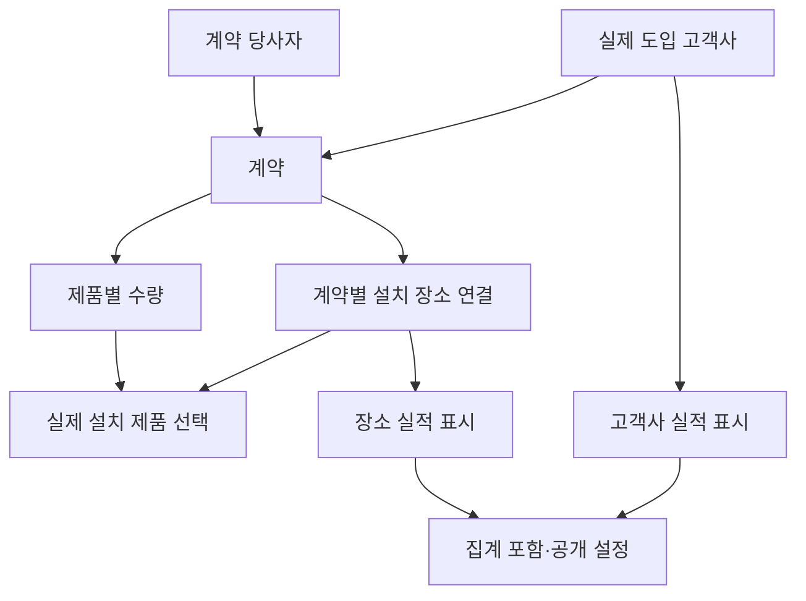

# GITSN 2단계 — 데이터 관계·업무 규칙 설계 초안
기준일: 2026-10-15
상태: 확정 핵심 모델·초기 마이그레이션 파일 작성. 남은 정책 확인과 PostgreSQL 검증 전이며 2단계 전체 완료 아님.

## 진행 조건
1단계의 프로젝트·패키지·기본 검사는 준비됐다.
실제 PostgreSQL 연결·Docker 기동·대응 Chromium 실행 검증은 남아 있다.
사용자와 합의한 대로 2단계 관계·규칙 정리 및 DB 비의존 로직은 진행하고 실제 DB 적용은 보류한다.
사용자가 확정한 관계·수량 규칙으로 핵심 모델과 초기 마이그레이션 파일을 작성했다. 미정 정책을 임의 구현하지 않고 실제 DB 적용은 보류한다. 현재 모델과 검증 범위는 stage2-schema.md를 따른다.

## 확정된 관계
| 항목 | 별도 관리할 이유 | 확정된 정보 |
|---|---|---|
| 계약 당사자 | 실제 구매 계약의 주체를 보존 | 기본 중복 판단의 기준 |
| 실제 도입 고객사 | 영업 실적으로 보여줄 고객과 계약 당사자가 다를 수 있음 | 계약 1건당 정확히 1곳. 같은 고객사는 여러 계약 가능 |
| 설치 장소 | 해수욕장 등의 예외 실적과 장소별 제품 표시 | 한 계약에 여러 장소 가능 |
| 계약 | 추가 계약과 유효 여부를 구분 | 같은 고객사의 여러 계약 보존, 계약일 선택 |
| 계약 제품·수량 | 수량의 유일한 입력 원본 | 한 계약에 여러 제품, 수량은 계약 제품별 전체 수량 |
| 장소별 제품 | 설치하지 않은 제품의 표시 방지 | 해당 계약 제품 중 실제 제품만 선택, 장소별 수량 없음 |
| 실적 표시·집계 설정 | 계약 주체와 영업 표시 대상을 구분 | 집계 포함·고객사/장소 표시·공개 여부는 별개 |
| 이용자 | 직원·파트너사의 정보 범위 및 기획팀 관리 권한 구분 | 파트너사 공통 범위, 출처는 기획팀만 |

## 관계 제안 — 아직 DB 구조 확정 아님
계약 수량 원본과 표시 대상을 분리한다. 같은 기관을 계약 주체·도입 고객사 두 역할로 선택해도 기관 기록 자체는 재사용한다.

- [제안] 기관 정보는 재사용하고 계약상 역할은 연결 정보로 구분한다.
- [제안] 고객사와 설치 장소의 표시 대상에 각각 안정적인 식별값을 부여한다.
- [제안] 같은 계약·제품 조합은 하나의 수량 원본으로 관리한다.
- [제안] 장소별 제품 선택은 계약 제품 원본을 참조하되 수량을 복사하지 않는다.
- [확정 A] 계약 한 건에는 실제 도입 고객사 한 곳만 연결한다. 고객사 한 곳에 여러 계약을 연결할 수 있고 계약 한 건에는 여러 설치 장소를 연결할 수 있다. 여러 도입 고객사에 나누어 연결하는 계약 구조는 1차 범위에 추가하지 않는다.
- [확인 필요] 같은 설치 장소를 서로 다른 도입 고객사가 공유하거나 담당 기관이 변경되는 경우의 처리.
- [확인 필요] 고객사와 그 설치 장소를 동시에 표시할지. 초기 집계값은 아래 확정 기준을 적용한다.
- 이 제안을 확정된 DB의 다대일/다대다 관계로 임의 고정하지 않는다.

## 항목별 입력 기준
| 대상 | 확정 항목 | 미정 |
|---|---|---|
| 고객사·표시 대상 | 공식 명칭·단일 고객 분류·집계 선택·고객사/장소 표시 선택·공개 여부 | 표시 대상 생성 방식·다른 표기 관리 |
| 지역 | 지방자치단체·의회만 필수, 수도권/충청권/호남권/영남권/강원권 | 제주 등 대응표·예외 장소 분류 |
| 계약·제품 | 제품과 제품별 수량, 계약일 선택, 유효 여부 구분 | 관계 입력 방식·유효값 초기 설정. 수량은 1 이상 정수로 확정 |
| 심볼·메모 | 선택, 심볼이 없으면 기본 표시 | 파일 형식·용량·저장 위치 |
| 출처 | 메일 제목·수신일·발신자 모두 선택, 원본 파일 미보관 | 없음 |
| 이용자 | 직원/파트너사 열람 구분, 기획팀 관리 권한 | 계정 발급 단위·수동 재설정 주기 |

제품·수량은 고객사 등록 화면에서 입력하더라도 계약 제품 원본에 한 번만 기록한다.
입력 화면의 위치와 자료의 저장 원본을 혼동하지 않는다.

## 집계 분리 원칙 — 확정
1. 계약 제품 수량: 같은 계약·제품 원본을 한 번만 합산한다. 서로 다른 계약의 같은 수량은 각각 더한다.
2. 고객사 수: 기획팀이 집계 대상으로 선택한 안정 식별값을 중복 없이 센다. 제품 수·계약 수·장소 연결 수로 대체하지 않는다.
3. 제품 마킹: 같은 제품은 한 번만 표시하고 새 제품이 도입되면 추가한다.
4. 조건 선택: 제품·분류에 맞는 고객사만 집계한다. 제품 복수 선택은 그중 하나 이상 도입한 고객사로 한다(2026-10-19 확정, 5단계 변경 반영). 고객 분류도 복수 선택 가능하며 선택한 분류 중 하나에 속하면 포함한다. 지역은 조회 조건에서 제외했다(카드·상세의 지역 표기는 유지).
5. 파트너사: 공개 목록과 비공개 수만 제공한다. 같은 조건의 전체 고객사 수는 직원과 같다.
6. 계약 종료: 유효 계약이 남으면 고객사 수 유지, 전부 종료되면 목록·집계 제외. 종료 계약 기록은 남기고 현재 수량·마킹은 유효한 계약만 기준으로 계산한다.

## 기본 집계값 — 사용자 확정
신규 고객사는 기본 집계 포함, 설치 장소는 기본 집계 제외로 시작한다.
기획팀이 예외 장소를 집계 포함으로 바꾸면 독립된 실적으로 센다.
이것은 등록 시 초기값이며 기획팀이 변경할 수 있다. 기존에 저장된 선택을 덮어쓰지 않는다. 공개 여부 기본값과는 독립적이다.

가상 예:
- 시청 1곳 + 연결된 해수욕장 2곳, 장소를 아직 집계 대상으로 선택하지 않음 → 총 1곳.
- 해수욕장 2곳을 모두 별도 집계 대상으로 선택 → 총 3곳.
- 동일 장소에 추가 계약 → 해당 장소의 수는 증가하지 않음.
고객사/설치 장소 목록의 동시 표출 방식은 이 집계 기본값과 별도로 확인한다.
사용자가 2026-10-15 승인했으며 DB 비의존 기본값 로직에 반영했다. 실제 DB 모델·적용은 나머지 관계 확인과 DB 환경 검증 후 진행한다.

## DB 없이 검증한 범위
delivery/domain/aggregates.py는 저장 구조와 무관한 확정 집계 원칙만 구현한다.
- 같은 계약·제품 수량이 장소 연결 때문에 반복돼도 한 번만 합산.
- 서로 다른 계약의 10대·5대는 15대.
- 서로 다른 계약의 같은 수량은 각각 합산.
- 동일 계약·제품에 서로 다른 수량이 전달되면 임의 선택하지 않고 오류.
- 제품이 여러 종류여도 집계 대상 식별값이 같으면 한 곳.

이 로직은 유효 계약 선택, 제품 필터, 장소/고객사 표시 결정, 공개 범위 조회를 대신하지 않는다.
호출 계층이 확정 규칙에 맞는 계약·표시 대상만 입력해야 한다.
DB 연결·마이그레이션·HTTP 응답·권한 검증을 완료했다는 의미가 아니다.

## 2단계 완료까지 남은 작업
1. 집계·표시 허용 조합 확인(초기 집계 기본값은 확정).
2. 실제 도입 고객사 1곳/계약 관계는 확정. 장소 공유·소속 변경 등 남은 허용 관계만 확인.
3. 출처는 메일 제목·수신일·발신자 모두 선택으로 확정. 수량은 확정하여 검증에 반영.
4. 핵심 모델·제약·초기 마이그레이션 파일 작성 완료. 미정 정책에 의존하는 부분은 보류.
5. PostgreSQL 17에서 적용·재적용과 집계·예외 사례 검증.
6. 화면·PDF가 공통으로 사용할 조회·권한별 출력 자료 서비스 구현 및 검증.

1~3은 사용자 답변이 필요하며, 실제 DB 검증에는 1단계 환경 제한 해소가 필요하다.
아직 결정하지 않은 규칙을 임의 기본값으로 채워 2단계 완료로 처리하지 않는다.

## 제품 수량 입력 — 사용자 확정
제품 수량은 1 이상 정수만 허용하고 0·음수·소수·빈 값은 거부한다. PostgreSQL bigint 저장 범위를 기술적 한계로 적용하며 임의 업무 상한은 추가하지 않는다.

## 종료 계약 정책 — 사용자 확정
현재 제품 마킹·수량 합계는 유효 계약만 기준으로 계산한다. 종료 계약 원본·제품·수량은 과거 기록으로 유지한다. 같은 제품의 다른 유효 계약이 남으면 마킹을 유지하고 유효 수량만 합산한다. 모든 계약 종료 시 현재 목록·집계에서 빠지지만 기록은 삭제하지 않는다.
내부 ORM 조회 파일은 작성했으며 실제 DB 실행은 미검증이다. 현재 자료와 과거 기록을 섞어 합산하지 않는다.

## 제품 복수 선택 — 사용자 확정
제품은 복수 선택하며 선택한 제품을 모두 가진 동일 고객사만 조회·집계한다. C와 I를 고르면 한 제품만 도입한 고객사는 제외한다. 같은 고객사의 서로 다른 유효 계약 제품도 합쳐 판단한다. 종료 계약 제품은 제외하며 제품 미선택 시 제한하지 않는다. 장소 별도 실적에는 해당 장소의 실제 제품만 적용한다. 목록·총수·분류별 수·비공개 수·출력에 같은 조건을 적용한다. 현재 코드는 내부 조회만 작성했으며 권한별 응답·화면·출력 연결과 실제 DB 실행은 미검증이다.

## 목록 표시와 집계 — 사용자 확정
목록 표시(show_in_list)와 고객사 수 포함(include_in_total)은 각각 저장한다. 집계 제외 장소도 표시 가능하고 목록에서 숨겨도 집계 설정을 덮어쓰지 않는다. 시청과 해수욕장 모두 표시·시청만 집계 시 목록 2개/총 1곳, 장소 포함 시 목록 수 그대로/총 2곳이다. 공개 설정은 별도이며 비공개 개별 정보의 파트너사 제공은 금지한다. 물리적 설치 장소만 등록하면 목록 항목이 생기지 않는다. 기존 표시용 기록의 노출을 유지하도록 show_in_list를 True로 초기화하며 기획팀이 별도 변경할 수 있다. 현재 계약·제품 조건은 목록 후보와 집계 후보에 공통 적용하고 목록 표시 필터를 집계에 사용하지 않는다. 분류 조건 및 권한별 응답·화면 연결은 별도 검증이 필요하다.
